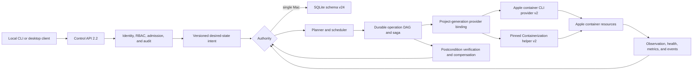

# Hostwright v0.0.2 Local Release Plan

The active release target is `v0.0.2`: a reliable single-Mac CLI, native desktop app,
and narrow Compose conversion workflow. The current source prepares `0.0.2-rc.11`; RC and GA publication
remain gated on exact-source and artifact qualification. Scope decision: [ADR 0015](../../design/adr-0015-reduced-local-release.md).

The ledger preserves one master issue, 15 phase epics, and 167 child workstreams.
Of the 78 issues open at the original scope decision, 28 were retained and 50
deferred. The October 8 amendment returns #282 to required work: 29 retained and
49 deferred from that original set.
Phases 01–09 remain closed with their historical evidence; later changes receive
regression coverage for the supported local product under [ADR 0016](../../design/adr-0016-release-focused-test-suite.md). A deferred closure is not completed implementation.

The original daily targets, 2026-07-13 through 2026-07-27, are historical. Delivery
now follows dependencies: scope reset → Phase 10 → Phase 13 → Phase 14 → Phase 15.
There is no replacement calendar deadline or promise for deferred work.

## Reduced Phase Requirements

| Phase / epic | Required for v0.0.2 | Deferred issues |
| --- | --- | --- |
| 10 / #219 | #207–#209 and #213–#215: local CPU/memory admission/release, hard filters, deterministic packing, stable placement, explanations and safe pressure deferral. | #210–#212 and #216–#218: fairness guarantees, topology optimization, automatic preemption, VM reclamation and accelerators. |
| 11 / #235 | Preserve development code with explicit unsupported status and release-boundary tests under ADR 0016. | #220–#235: all multi-Mac, consensus, remote operations, HA and cluster recovery requirements. |
| 12 / #247 | Preserve development contracts without Kubernetes compatibility claims. | #236–#247: sandbox VM, CRI/CNI/CSI, kubelet, Helm and conformance. |
| 13 / #257 | #250: existing Compose subset import/export/update planning, explicit loss reports, and real execution through normal Hostwright lifecycle commands. | #248–#249 and #251–#256: Docker socket/API, Podman, Testcontainers and dedicated CI/IDE integrations. |
| 14 / #270 | #258–#262: signed local SwiftUI/menu-bar app, manifest selection, services/health/logs/events, reviewed up/down/restart, accessibility and package upgrade/rollback. | #263–#269: team/MDM/cloud/SSO/fleet/remote support. Full CLI parity and automatic updates are removed from retained requirements. |
| 15 / #283 | #271–#281: bounded local qualification, security, recovery, upgrade lineage, docs, support, signed artifacts and vendor tap.  | #282: official Homebrew distribution; core source-build formula, physical cluster and broad client requirements. |

The [issue manifest](issues.json) owns each retained issue's reduced acceptance
criteria and required evidence. The [generated index](WORKSTREAM_INDEX.md) lists
all historical identities and release dispositions. #284 remains the master gate.

## Locked Architecture

### Control and mutation flow

Each mutation is: validated intent → authorization → durable fencing token → checkpointed steps → provider call → observed postcondition → commit, compensation, or operator-visible hold. Runtime calls never occur inside a database transaction. A crash at any checkpoint is resumable and cannot make a second provider opportunistically take over the same project generation.

### Identity and ownership

- Every project, workload, operation, volume, network, secret binding, node, and cluster object has a Hostwright UUID.
- Apple resource names and labels are attributes and lookup aids, never primary identity.
- Ownership records bind UUID, project generation, provider, resource generation, and fencing token.
- Garbage collection requires positive Hostwright ownership, observed identity agreement, retention eligibility, and a finalizer/reclaim decision.
- Hostwright never deletes an unmanaged resource to make desired state “look clean.”

### State authority

- SQLite remains authoritative for a standalone Mac and node-local caches/ledgers.
- Cluster state and managed etcd remain development-only; they are deferred from v0.0.2.
- Hostwright does not invent a consensus algorithm.
- Local release authority never depends on a cluster or a cloud service.

### Runtime providers

- Runtime Provider API v2 defines observation, lifecycle, process control, streaming, images, networks, storage, cancellation, timeouts, errors, capabilities, and cleanup.
- Apple CLI and direct Containerization implementations run the same conformance suite.
- One project generation has one mutation provider. Provider migration is explicit, fenced, verified, and recoverable.
- Containerization runs behind a pinned out-of-process helper and versioned protocol so Swift package pinning and crashes do not destabilize the control plane.

### Kubernetes boundary

Kubernetes and the proposed pod-sandbox VM, CRI, CNI, and CSI adapters are deferred. Existing guest-agent contracts do not establish a running VM or Kubernetes conformance.

### Extensions and accelerators

- Capability-limited WASI is the default extension model.
- Signed XPC services are allowed only for native Apple capabilities WASI cannot provide.
- Direct guest GPU/ANE passthrough is not fabricated without a supported public Apple API.
- Host-native Metal, Core ML, and MLX services are deferred and unavailable in this release.

## Breaking Contracts Locked in Phase 01

| Contract | v0.0.2 version | Compatibility rule | Migration rule |
| --- | ---: | --- | --- |
| Manifest | 3 | Manifest v3 is the active breaking contract; versionless and v1/v2 input are legacy and are accepted only by explicit migration preview. | `hostwright migrate preview` produces deterministic read-only v3 output, maps legacy flat resource values to both request and limit, and refuses legacy resource-less workloads that need a manual capacity declaration. |
| Control API | 2 (current protocol revision 2.2) | API N/N-1 is required once API v2 is released; current v1 requests fail explicitly. | Clients negotiate a version and receive stable unsupported-version errors. |
| Runtime Provider API | 2 | Provider capability negotiation is mandatory. | Projects stay bound to their generation’s provider until an explicit fenced migration. |
| Plugin ABI | 1 | Capability manifests and protocol version are checked before launch. | No ambient-privilege compatibility shim; incompatible plugins remain quarantined. |
| State schema | 24 | Newer schemas fail closed; migrations are contiguous, checksummed, and preserve historical authority. | Deterministic UUID/fencing backfill through v24; real upgrade/restore and Phase 10 recovery evidence is required. |

## Local Product Interfaces

- Local scheduling enforces explicit requests/limits, provider and ownership binding,
  deterministic packing and safe pressure deferral. Unsupported policies fail before
  mutation; no cross-project fairness, topology, preemption or accelerator support is claimed.
- Compose conversion retains its existing narrow field subset and loss reporting.
  Execution uses the generated Manifest v3 through ordinary confirmed lifecycle commands.
- Desktop uses authenticated Control API 2.2. Manifest selection, status, logs and
  events accompany reviewed up/down/restart. Confirmation binds the exact current
  plan; changed intent requires a fresh preview. No direct runtime or SQLite access.
- Retain the existing native split-view design, system typography and semantic colors.
  Verify keyboard/VoiceOver, light/dark appearance, normal/narrow windows and errors.
- Supported distribution contains the local CLI, signed app and required helpers.
  Deferred tools remain outside supported packaging and capabilities remain explicit.

## Verification and Closure

[ADR 0017](../../design/adr-0017-focused-v002-qualification.md) supersedes the prior
qualification budget and Homebrew launch dependency. Complete five groups: source,
artifact integrity, clean installation, working product and documentation. Run one
lifecycle per declared provider, retain targeted regression evidence and the trusted
stage's one full source suite. No repeated ten-cycle budget, separate timed soak,
mandatory full sanitizer/fuzz campaign or agent-review receipt remains.

Preserve clean source and exact signed inventory bindings, actual results, state/
workload recovery and owned cleanup. Required issues close with verified evidence;
#282 closes as not planned. Publish signed downloads and the verified vendor tap,
then close #281, #283 and #284 after their required evidence is complete.
