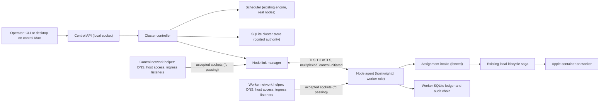
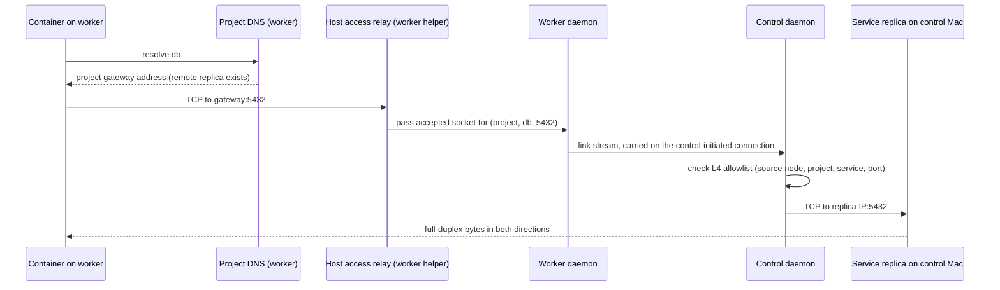

# Hostwright v0.0.3 implementation plan: multi-Mac cluster

Status: accepted in [ADR 0018](../../design/adr-0018-multi-mac-cluster-mode.md).
Date: 2026-11-20. Base: `main` at `5eeebbe3`.
Companion: [READINESS_REVIEW.md](READINESS_REVIEW.md) (CI timing, cluster-code test results, test-suite survey).

This plan turns Hostwright from a single-Mac control plane into a cluster of Macs: one control Mac plus worker Macs. Containers can run on any Mac and reach each other's services. The target is a complete product. Once it runs, we use it to find what it still cannot do, and that list seeds v0.0.4.

The hard limits are a **$60 one-time** budget for rented hardware, one physical Mac plus one macOS VM in the lab, and a solo maintainer.

## Contents

1. [Goal and definition of complete](#1-goal-and-definition-of-complete)
2. [Constraints](#2-constraints)
3. [Architecture decisions](#3-architecture-decisions)
4. [Architecture overview](#4-architecture-overview)
5. [Contract, schema, and capability changes](#5-contract-schema-and-capability-changes)
6. [Work plan](#6-work-plan)
7. [Test strategy](#7-test-strategy)
8. [Budget and proof day](#8-budget-and-proof-day)
9. [Funding and free infrastructure](#9-funding-and-free-infrastructure)
10. [Risks](#10-risks)
11. [Process changes from v0.0.2](#11-process-changes-from-v002)
12. [Governance compliance](#12-governance-compliance)
13. [Sizing](#13-sizing)
14. [For reviewers](#14-for-reviewers)

---

## 1. Goal and definition of complete

**Goal.** An operator on the control Mac declares services in `hostwright.yaml`. Hostwright places replicas across enrolled Macs, connects them over authenticated encrypted links, keeps them running through restarts and network loss, and shows one status and one audit history for the whole cluster. The safety model of v0.0.2 still holds: Hostwright confirms the plan before it changes anything, fences every mutation, removes only resources it owns, and fails closed when unsure.

**Shape.** This is a single control plane, close to how k3s runs by default: one server with a SQLite store, and agents that join with a token. A highly available control plane (managed etcd with three or more control Macs) is out of scope for v0.0.3 and is the main v0.0.4 candidate.

### Capability matrix (the definition of "complete")

"Supported" means it passes the proof scenarios in section 7. "Partial" means it works with a documented limit. "Out" means it is refused before any effect, with a stable error.

| Kubernetes concept | v0.0.3 | Notes |
|---|---|---|
| Cluster bootstrap, join with token | Supported | `hostwright cluster init`, `node add`, `node join` |
| Highly available control plane | Out | One control Mac. Managed etcd code stays development-only (v0.0.4). |
| Nodes: conditions, labels, taints | Supported | Ready, NotReady, Unknown; operator-managed labels and taints |
| Cordon, uncordon, drain | Supported | Drain honors disruption budgets. Stateful services need an explicit decision. |
| Deployment / ReplicaSet | Supported | Services with `replicas`, placed per replica |
| Rolling update across nodes | Supported | Existing per-node update DAG, ordered across nodes by disruption budget |
| DaemonSet | Partial | Emulated with `topologySpread` plus replica count; no automatic scale with node count |
| StatefulSet | Partial | A volume pins its service to one node; no ordered identity across nodes |
| Job / CronJob | Out | Manifest v3 has no job kind. `hostwright run --service` creates one ephemeral instance of one service (`docs/reference/cli.md:566`), placed by the scheduler across Macs (V3-89). |
| Service discovery (ClusterIP plus DNS) | Supported | DNS names resolve to local replicas or to the project gateway for remote ones. No virtual IP. Two remote services of one project cannot share a port on a node (D10). |
| Ingress (HTTP, WebSocket) | Supported | Ingress on any node can route to replicas on other nodes |
| NodePort / LoadBalancer, generic TCP | Partial | TCP between services works; host-level TCP exposure across nodes is limited to existing ingress and tunnel modes |
| UDP between nodes | Out | Tunnels are TCP. UDP works only inside one Mac. |
| NetworkPolicy | Partial | Cross-node L4 allowlist (project, service, port, source node) at the receiving node. In-guest policy only on the native provider, as today. |
| Secrets | Supported | Delivered only to nodes the operator allows; bound to workload generation; deleted on removal |
| ConfigMap | Partial | `env` and bind/volume mounts; no separate config object |
| Persistent volumes (node-local) | Supported | `hostwright-local` on the node that owns the volume; every service mounting it runs on that node |
| Host paths: bind mounts, `hostAccess`, file-based secret references | Partial | Pinned to the control Mac (D20) |
| Volume migration, remote volumes (CSI) | Out | |
| Requests, limits, affinity, anti-affinity, spread, taints, tolerations | Supported | Existing Manifest v3 `scheduling` fields. Preferred variants unblocked in this release. |
| Priority and preemption | Partial | Priority ordering yes. Preemption stays blocked: automatic eviction conflicts with explicit destructive confirmation. |
| Pod disruption budgets | Supported | Manifest `scheduling.disruption`, unblocked in this release |
| Autoscaling (HPA) | Out | |
| RBAC | Supported | Existing roles on the control Mac, extended with cluster resources and verbs |
| Admission policy | Supported | Existing admission engine on the control Mac |
| Image signature policy | Supported | Existing cosign trust, with node-bound records |
| Audit | Supported | Node-local tamper-evident chains, plus control records of every remote operation |
| Logs, exec, attach, events from the control Mac | Supported | Proxied over the node link |
| Metrics across nodes | Partial | Node capacity, pressure, and link metrics; no metrics pipeline |
| Version skew between control and nodes | Partial | Same release required to run workloads; a mismatched node stays visible as `VersionSkew` (D16) |
| Traffic between two workers | Partial | Relayed through the control Mac. Proven live only with three nodes (S15); otherwise on T1–T3. |
| Namespaces | Partial | Projects act as namespaces |
| `kubectl`, CRI, CNI, CSI, Helm | Out | Phase 12, unchanged |

### Non-goals for v0.0.3

- Consensus, quorum, or a replicated control store.
- A network-reachable Control API. Operators use the control Mac's CLI or desktop app.
- Overlay networks, VPNs, NetworkExtension, PF rules, kernel extensions, or a privileged helper.
- Routing container subnets between Macs.
- Kubernetes API compatibility.
- Cloud-hosted control, telemetry, or remote diagnostics upload.
- Automatic preemption or eviction without an operator decision.

---

## 2. Constraints

| Constraint | Consequence |
|---|---|
| $60 one-time rental budget | One guaranteed 24-hour AWS `mac-m4.metal` day (a second only if the first bill leaves room), or about four 3-node days on Scaleway if it offers macOS 26 (section 8) |
| Lab: one M4 Pro Mac, one macOS VM | The VM can run the node agent and network tests, but not containers. Apple `container` needs bare-metal macOS 26. |
| Apple `container` needs macOS 26 on bare metal | Rented workers must be bare metal (EC2 Mac or Scaleway Mac mini), never a macOS VM |
| No privileged helper (`docs/architecture/daemon.md`, `networking-boundary.md`) | All networking stays in user space, inside the existing per-user network helper |
| Per-user LaunchAgent in `gui/<uid>` | Every node needs a logged-in GUI session with an unlocked login Keychain |
| Local Network privacy on macOS 15+ | A per-user LaunchAgent that dials or listens on the LAN gets a consent prompt on each Mac, possibly again after every upgrade (V3-14). Root daemons are exempt, but Hostwright has none. |
| Single maintainer, AI-assisted | Vertical slices behind feature flags, with each phase demonstrable on its own |
| PR CI about 35 min, release pipeline about 161 min | Phase 0 fixes this before cluster work multiplies it |

---

## 3. Architecture decisions

Each decision lists the reason and the alternatives rejected. ADR 0018 (V3-12) records all of them; the maintainer's approval of that ADR is the gate for Phase 1.

### D1. Clustering lives in core as an opt-in mode

Cluster mode is off by default and enabled per installation (`hostwright cluster init` on the control Mac, `node join` on workers). A Mac that never joins behaves exactly like v0.0.2.

- **Reason:** cluster features need the same saga, fencing, ownership, and policy code as single-Mac features. A separate project would fork them.
- **Rejected:**
  - Plugin or separate repository. `docs/architecture/multi-host-platform-research.md` preferred this, but it would duplicate the lifecycle saga and the safety guarantees.
- **Governance:** ADR 0018 supersedes the single-host decisions in `multi-host-platform-research.md` and `control-plane-direction.md`. Section 12 maps every gate item from those documents to this plan.

### D2. One control Mac is the authority; SQLite stays the store

- The control Mac's SQLite database is authoritative for cluster state: membership, assignments, placements, cluster operation groups.
- Each worker keeps its own SQLite ledger as the authority for what it executed locally.
- No consensus. `docs/roadmap/v0.0.2/IMPLEMENTATION_PLAN.md` says "Hostwright does not invent a consensus algorithm", and this plan keeps that.
- **What happens when the control Mac is lost:**
  - Workers keep running their assigned workloads.
  - No new changes are possible.
  - The cluster CA private key is a non-exportable Keychain key (`ClusterCertificateLifecycle.swift`), so a replacement control Mac cannot inherit it. Recovery means a new cluster and re-enrolling every worker. The docs must say this plainly.
  - The cluster store is backed up with the existing state backup and restore. That keeps assignments and history, but not the CA key.
- **Restoring an older store on the same control Mac:** the CA survives, but workers may have accepted newer assignments since the backup, and the fencing check refuses stale or unexpected epochs and tokens (`ClusterMutationFence.swift:505-540`). The restored control Mac therefore starts in a **recovery hold**: no placements, mutations, or secret deliveries until it has read every reachable worker's accepted generations and fencing tokens and moved its own counters past them. A worker that stays offline stays held until it reconnects or is re-enrolled (V3-68).
  - Workers can report their latest fencing tokens, but none can tell the control Mac that a secret grant was withdrawn or a node revoked after the backup. So, after a restore, **every secret grant and every node identity counts as uncertain and stays denied** until the operator explicitly reauthorizes it (`cluster policy secrets allow` again; `node reauthorize <name>` per node). An operator who revoked a node or withdrew a grant after the backup simply does not reauthorize it. The 7-day certificate lifetime bounds how long a missed revocation could matter.
- **Rejected:** managed etcd now. It needs three or more control Macs to prove quorum behavior, which the budget cannot buy on AWS. It stays development-only for v0.0.4.

### D3. Workers reconcile fenced assignments locally (the kubelet model)

The control Mac decides *what* runs *where*. Each worker runs the existing v0.0.2 local lifecycle path to make it so (plan, admission, saga, probes, restart policy), with a placement filter, adopted identities, and multi-project reconcile added (below).

- **Reason:** the code rules out the alternative of treating a worker as one more `RuntimeAdapter` called remotely:
  - The provider set is closed (`RuntimeCapabilityNegotiation.swift:8-11`).
  - Runtime models such as `DesiredRuntimeState` and `ObservedRuntimeState` are not `Codable`.
  - The activation gate is an in-process `@TaskLocal` (`RuntimeActivationAuthority.swift:10`).
  - Network, DNS, storage, tunnels, probes, bind-mount leases, and Keychain secrets all bypass the adapter (`LifecycleLiveDriverExecution.swift`, `LifecycleLiveEffects.swift`, `CLIEnvironment.swift`).
  - HTTP and TCP probes run in the host process against loopback ports, so they must run on the worker.
- **What a worker receives (the assignment):**
  - The **full** canonical manifest of the project and its SHA-256, never a partial manifest. Validation runs against the whole file, so `dependsOn` references and project-level declarations resolve the same way on every Mac.
  - A **placement map:** for each service, the global replica indexes assigned to this node. Today `ManifestRuntimeMapper.swift:68` expands `replicas: N` into indexes `0..<N` on the spot, so two Macs each told "one replica" would both build replica 0. The mapper gains a filter: a node builds desired state only for its own indexes, and names (`replica-<index>`, `:114`) stay unique across the cluster.
  - Placement IDs minted by the control Mac (below).
  - Remote gates for dependencies on services placed elsewhere (D4), and the node's endpoint slice (D10). Readiness facts arrive during execution, not in the plan.
  - The node plan SHA covers the manifest SHA, this node's placement map, the placement IDs, and the remote gates (identities, conditions, expected generations, never observed values), on top of local observation as today.
- **Slice validation:** today the planner requires a service's local replica indexes to be exactly `0..<count` and every dependency to exist locally (`MultiServiceReconciliationPlanner.swift:809`, `:831`), so a worker given only `web[1]` fails with `invalidReplicaSet`. In cluster mode the full topology is validated once on the control Mac. Each worker validates its slice against its placement map: its replica indexes must equal the assigned set, and a dependency on a service placed elsewhere becomes a remote gate instead of `missingDependency`. Standalone validation is unchanged.
- **Replica identity:**
  - Today the project UUID falls back to a name-derived value (`ManifestRuntimeMapper.swift:44-49`, `HostwrightResourceUUID.legacy`, `ResourceUUID.swift:9`), and `ownership_records` has no node column. A replica re-placed from node A to node B under the same UUID would leave two owned resources sharing one identity during a partition.
  - In cluster mode, the control Mac mints a **placement ID** per (project, service, replica index, node UUID, placement epoch). The worker adopts it as the resource UUID of the replica's first revision instead of deriving one.
  - The placement epoch increases only when a replica moves to another node. A same-node `up` or `update` keeps the placement ID.
  - Revision UUIDs follow the existing update logic: a candidate gets its own UUID derived from the current one (`LifecycleCommandRunner.swift:1091-1095`), and current and candidate must differ while both exist (`LifecycleUpdatePlanner.swift:2314-2320`). Plans, ownership, fencing, recovery, and cleanup bind the exact revision UUID; the placement ID ties every revision of one placement together.
  - Ownership records gain node UUID, placement ID, and placement epoch (schema v25).
  - Re-placement always mints a new placement ID, so the stale copy on the old node stays distinguishable and is stopped under the newer fencing token (D15). `node remove` and `node reset` delete only identities the node owns.
- **Project-scoped resources:**
  - A node creates a project's networks and DNS only when it hosts at least one replica of that project.
  - A volume lives on exactly one node. All services that mount it form a co-location group that the scheduler places together (D13).
- **Validation that stays as it is:** `replicas cannot share fixed localhost ports` (`ManifestValidator.swift:2496`) remains a manifest-level rule, even though replicas on different Macs could reuse a port. Relaxing it would make a manifest valid or invalid depending on placement.
- **Daemon scope:** today the daemon reconciles the one manifest named by `--config` (`DaemonCore.swift:466`, `docs/architecture/daemon.md`). In cluster mode, control and worker daemons reconcile the set of accepted assignments from their own store, with one project-scoped operation group per project as today. Standalone mode keeps `--config` (V3-86).
- **Consequences:**
  - Workers keep restarting crashed workloads during a network partition (static stability).
  - The existing single-Mac code paths stay the execution engine, with three additions: the placement filter, adopted identities, and multi-project reconcile (V3-85, V3-86). Without a placement map, the standalone path behaves exactly as in v0.0.2.
- **Rejected:** a remote `RuntimeAdapter`, for the reasons above and because a partition would stop all restarts.

### D4. Plan confirmation spans nodes

- `hostwright up <manifest> --dry-run` on the control Mac:
  1. computes placement;
  2. asks each affected worker for its **node plan** for its assignment slice;
  3. prints the cluster plan with a `clusterPlanSHA256`. That hash is the SHA-256 of the canonical ordered list of `(nodeUUID, assignmentGeneration, nodePlanSHA256)` plus the canonical list of cross-node dependency edges (below).
- `hostwright up <manifest> --confirm-plan <clusterPlanSHA256>`:
  1. sends each worker its assignment with the expected node plan hash;
  2. each worker re-observes, recomputes, and refuses on mismatch with the same meaning as `HW-CLI-003`.
- **Dependencies across Macs: one action graph, not whole-node waves.** Sending each Mac its whole slice in waves deadlocks on `db@A → api@B → web@A`, and hashing observed readiness would make expected progress invalidate the confirmation.
  - Today the planner turns `dependsOn` (`started`, `ready`, `completed`; `ManifestModel.swift:1194-1196`) into per-replica action edges (`MultiServiceReconciliationPlanner.swift:461-500`).
  - In cluster mode, a dependency on a service placed elsewhere becomes a **remote gate** in the dependent node's plan: wait for a condition of a named identity at an expected placement generation. A gate never contains the observed value, so `db` becoming ready changes no hash.
  - Each node runs its saga until it reaches an unsatisfied remote gate and persists that point. When the control Mac sees the condition reached on the other node, it sends a fresh readiness fact stamped with the placement generation and a monotonic observation sequence from the reporting node. The worker accepts it only if it matches the gate's generation and is the newest observation of that identity it has seen, so a delayed `Ready` report that arrives after the service turned unhealthy, within the same generation, fails closed. The sequence is persisted on the reporting node, or paired with a per-boot ID, so a worker restart never makes its fresh reports look older than ones it sent before.
  - A node can be visited several times in one operation: for `db@A → api@B → web@A`, A starts `db`, then B starts `api`, then A starts `web`.
  - Progress is persisted at every action boundary on both sides, so an interrupted operation resumes at the same gate, and teardown walks the graph in reverse.
  - Until V3-87 lands, placement either co-locates services that depend on each other or refuses.
- **Every lifecycle verb** (`up`, `down`, `start`, `stop`, `restart`, `rm`, `update`, `run`; `LifecyclePlan.swift:14-22`) uses the same cluster dry run and confirmation:
  - `down`, `stop`, and `rm` walk the action graph in reverse.
  - `run` places a one-off service run with the same scheduler.
  - `update` follows the cross-node rolling update (V3-66).
  - `cleanup --dry-run` returns one token per node, all bound under the cluster confirmation.
  - `up` and `down` land in Phase 1 (V3-28, V3-88); the rest in Phase 2 (V3-89).
- **Atomicity:** a saga is atomic per node, and the cluster as a whole is not. A cluster operation group records each node's outcome: executed, refused, failed, unreachable, or held at a remote gate. The CLI prints the outcome per node, including any safe hold and its recovery command, with the exact retry command. The operator reruns `--dry-run` to converge. Nothing retries silently with a different plan.
- **Rejected:** a two-phase commit across Macs. That is consensus by another name, and it blocks when a node is unreachable.

### D5. No network Control API

- The Control API stays on the local Unix socket with kernel peer credentials and code-signature checks (`ControlPeerAuthenticator.swift`).
- Operators work on the control Mac.
- Node-to-node traffic uses a separate, narrow cluster protocol (D7).
- On a worker, the local Control API serves reads. It refuses mutations to resources the cluster owns, with a stable error that names the control Mac. Local projects that are not cluster-owned keep working, and their reservations are reported as used capacity.
- **Rejected:** exposing the Control API over TCP. It would put every local operation behind network authentication and widen the attack surface for no product gain.

### D6. Workers run the same `hostwrightd` with a worker role

- **No new executable.** Three things are fixed and would make a new binary expensive:
  - the executable inventory (`DistributionModels.swift:25-38`);
  - the single owned LaunchAgent label `dev.hostwright.daemon`;
  - the control-identifier set, which `validate()` requires to equal its default (`ControlPeerAuthenticator.swift:76`).
- The daemon config gains a `role` (`standalone`, `control`, or `worker`).
- The network helper is started by the daemon on workers, rather than only by the CLI (`NetworkHelperClient.swift`).
- In cluster mode the daemon reconciles accepted assignments from its store instead of one `--config` manifest (D3, V3-86).

### D7. One control-initiated, multiplexed link per worker

- The control Mac dials each worker and keeps one long-lived TLS 1.3 connection with mutual authentication. All traffic multiplexes over it as independent streams in both directions:
  - RPC and heartbeats;
  - event replication;
  - logs, exec, and attach;
  - service traffic.
- **Reasons:**
  - The control Mac can sit behind home NAT with no inbound port. The proof setup is exactly that: control at home, worker on a public IP.
  - Service traffic must flow both ways. A container on the worker must reach a service on the control Mac. Carrying worker-to-control streams over the control-initiated connection makes that work without an inbound port.
  - Only workers expose a listener, and it accepts only cluster-CA client certificates from the control node, plus an IP allowlist.
- **Topology:** a star. Traffic between two workers is relayed through the control Mac in v0.0.3. Direct worker-to-worker links are a flagged optimization (`cluster.directWorkerLinks`), used only when both workers can reach each other.
- **Process ownership:**
  - `hostwrightd` owns the link and its multiplexer on both ends. It is the long-lived LaunchAgent, and control traffic must not depend on a process that exits when idle.
  - `hostwright-network-helper` keeps owning the listeners on gateway addresses (host access, ingress), as today.
  - When the helper accepts a connection bound for a remote endpoint, it passes the socket to the daemon (file descriptor passing over a local socket with the helper's existing code-signature and UID checks). The daemon carries the bytes as a link stream.
  - On the receiving node, the daemon connects to the ready replica's container IP directly. The host already reaches container IPs, as the ingress broker does.
  - In cluster mode the daemon starts and supervises the helper and keeps it alive while cluster bindings exist. Today only the CLI starts it, and it exits when idle (`NetworkHelperClient.swift`, `NetworkHelperServer.swift`).
  - Cost: one extra local hop through the daemon. V3-48 measures it.
- **Stream requirements:**
  - either side can open a stream on the control-initiated connection;
  - per-stream flow control;
  - bounded frames and stream count;
  - cancellation;
  - keepalive;
  - a priority lane so heartbeats and control RPC are never starved by bulk data.
- **Transport is chosen by a spike (V3-91) before V3-23.** Candidates:
  1. **QUIC in Network.framework.** Either side opens streams natively. Unconfirmed: whether a Network.framework QUIC listener accepts client certificates. One Apple forum reply doubts QUIC server support, and no source found shows mutual TLS over QUIC working.
  2. **gRPC or HTTP/2 over `swift-nio-transport-services`,** which uses Network.framework TLS. These packages are already resolved transitively through Apple's containerization package; using them directly adds direct dependencies and `third-party-license-inventory.json` entries. gRPC lets only the client start calls, so streams the worker opens still need an application-level multiplexer inside one long-lived bidirectional call.
  3. **A small hand-written multiplexer over Network.framework TLS 1.3.** This is the known-working baseline: `ServiceTunnelTransport.swift` already runs TLS 1.3 with mutual authentication on Network.framework.
- **Selection criteria:**
  - (a) the stream requirements above;
  - (b) mutual TLS with a non-exportable Keychain `SecIdentity`, which rules out plain `swift-nio-ssl` unless it signs through a custom key callback;
  - (c) the least new code to review and fuzz.
- **Rejected:**
  - Per-connection dialing in both directions, which fails behind NAT.
  - A relay server, which is a new hosted component.

### D8. Identity, join, rotation, revocation

- **Cluster CA:** `hostwright cluster init` creates the cluster UUID and the CA as a non-exportable Keychain key, reusing `ClusterCertificateLifecycle`.
- **Join token:** `hostwright node add <name> --address <host:port>` prints a single-use token once. It expires after 15 minutes, binds the node name, and carries the CA fingerprint. The control Mac keeps the token secret in its Keychain (`WhenUnlockedThisDeviceOnly`) until the token is used or expires, so a join still works after a control restart; SQLite keeps only the token ID, hash, bound name, and expiry. Single use is enforced by the consumed token ID (`consumedJoinTokenIDs`, `ClusterMembership.swift:385`). The token is never logged. The existing `ClusterJoinToken` expires only by membership epoch (`expiresAtEpoch`, `ClusterMembership.swift:241-262`); it gains a wall-clock expiry.
- **Existing contracts:**
  - `ClusterMembership` defines `voter` and `learner` roles with quorum rules for 1, 3, or 5 voters (`ClusterMembership.swift:139-142`). v0.0.3 uses one voter, the control Mac, and makes every worker a learner, so the existing quorum checks hold without consensus.
  - The existing node-agent transport contract is already named v1 (`hostwright-cluster-node-agent-v1`, 45 KiB payload cap, `NodeAgentTransport.swift:48-56`) and is local-only. The new link protocol takes a distinct name so the two cannot be confused.
  - V3-90 maps every existing cluster type to this plan: reuse, adapt, or retire.
- **Join:**
  1. On the worker, `hostwright node join` reads the token from echo-free standard input (`SecretInput.swift:27-40`), never from arguments, so it stays out of shell history and the process list. It creates the node's non-exportable key and opens a join-only listener with an ephemeral certificate.
  2. The control Mac dials it. The worker checks the CA fingerprint from the token.
  3. Both sides prove possession of the token secret with a MAC over the TLS exporter value (channel binding), so a relay cannot forward the exchange. V3-14 confirms that Network.framework exposes the exporter. **Fallback** if it does not: both sides MAC a transcript that includes the SHA-256 fingerprints of both certificates in the handshake, as each side observed them. The worker's ephemeral certificate and the control node's CA-signed client certificate are both covered, so a relay presenting a different certificate fails the check.
  4. The worker sends signing requests for its own public keys, and the control Mac issues node certificates for exactly those keys (`node-agent-server` and `node-agent-client` roles, `ClusterMutualTLSVerifier` SAN rules). Today `ClusterCertificateLifecycle` creates authority and leaf keys in one local Keychain (`:1161`, `:1235`), so issuing for a key generated on another Mac is new code (V3-24).
- **Certificates:** short-lived (default 7 days) and rotated over the link before expiry.
- **Expired while offline:** a node that stays offline past its certificate lifetime cannot reconnect, because renewal happens only over the link. `hostwright node add <name> --rejoin` issues a token bound to the existing node UUID, and `node join --rejoin` on the worker re-enrolls it. Its local ledger and accepted assignments are kept and reconcile on reconnect (D15, V3-94).
- **Removal:** `node remove` revokes the node's certificates, fences its live session, and closes its open streams at the control end; `ClusterSessionAuthority.revokeCredential` already fences active sessions (`ClusterSession.swift:1220-1232`). Reconnects are refused at the handshake. Removing a worker needs a new learner-removal transition, since today only voters can be removed (`ClusterMembership.swift:1084-1094`; V3-90). A node that is unreachable when removed keeps running until an operator runs `hostwright node reset` on it. The docs must say this plainly.
- **Rejected:** Bonjour discovery or pairing without a token. Discovery is not trust (`multi-host-platform-research.md`).

### D9. The existing scheduler gets real nodes

- **Already in place:** the scheduler engine accepts many nodes (`SchedulerEngine.swift:953`, `NodePlacementSnapshot` in `SchedulerContracts.swift:794`), and persisted reservations are already keyed by `node_uuid`.
- **Single-host assumptions to remove:**
  - a fixed node UUID (`LocalLifecycleScheduler.swift:11`);
  - `nodes.count == 1` (`:52`);
  - capacity from `ProcessInfo` (`:75-84`);
  - the label `hostwright.io/node: local` (`:110`);
  - one pressure sample applied to every node (`SchedulerPressureCoordination.swift`).
- **Runtime blockers to lift** (`ManifestSchedulerAdmissionBridge.swift:65-80`):
  - `preferredAffinity`
  - `preferredAntiAffinity`
  - `topologySpread.scheduleAnyway`
  - `disruption`, which drain needs
- **Blockers that stay:** `preemption`, `provider` claims, and accelerator claims.
- **Placement unit:** one service replica.
- **Authority:** placement on the control Mac is advisory. The worker's existing local admission stays the authority over its own capacity. If a worker refuses, the control Mac re-plans and shows the refusal.
- **Claim to verify:** Manifest v3 needs no new fields for placement, because all of these keys already parse (`ManifestParser.swift`, the `decodeScheduling` allowed list).

### D10. Cross-Mac service traffic reuses the service-tunnel code

Today a container can reach a remote service through this path (`ServiceTunnelTransport.swift`, `LifecycleLiveDriverExecution.swift:264-276`):

1. the host-access relay on the project gateway;
2. a local tunnel dialer;
3. TLS 1.3 with mTLS;
4. a remote listener;
5. a remote loopback port.

v0.0.3 keeps the local ends and replaces the middle with node-link streams.

- **Fixes to existing code:**
  - The listener-side forwarder is lockstep: it reads one frame, then one response (`ServiceTunnelTransport.swift`, around 1296-1336). Make it full duplex, or server-first and streaming protocols such as databases break.
  - Raise and configure the connection cap of 8 (`:1194`, `:1373`).
  - `acceptLocalOnly = true` (`:1682`) would refuse the public-IP worker. Cluster traffic arrives over the node link instead, and existing local tunnels keep their behavior.
  - Replace manual fingerprint pinning with cluster-CA identity for cluster streams.
  - Host access validates loopback targets as `127.0.0.1` (`NetworkHelperHostAccessValidation.swift`) and uses one port value for listen and target (`NetworkHelperHostAccessBroker.swift`). Two projects that use the same port would collide on loopback. Add an internal target kind that hands the accepted connection to the daemon (D7, process ownership), with no loopback port.
- **Discovery:** the control Mac computes a service endpoint map per project and pushes each node its slice. Each node's project CoreDNS (`ProjectDNSPlanner.swift`) answers a service name with:
  - local ready replica IPs, plus
  - the project gateway address when remote replicas exist.

  The host-access relay on the gateway hands the connection to the daemon, which maps the gateway port to (project, service, port) and opens a node-link stream to it. The receiving daemon delivers it to a ready local replica IP. The host already reaches container IPs; the ingress broker does today (`NetworkHelperIngressBroker.swift`).
- **One gateway per project, so gateway ports must be unique.** The relay sees only the gateway address and port, and keys its listeners on protocol, address, and port (`NetworkHelperHostAccessBroker.swift:123-131`); the DNS name is gone by then. So, per node and per project, every port exposed on the gateway (remote service endpoints and `hostAccess` bindings) must be unique, and placement refuses a plan that would expose two on one port, with an explanation. Separate addresses per remote service would need privilege; that is v0.0.4 work at the earliest.
- **Isolation:** the receiving node checks an L4 allowlist that the control Mac pushes: source node, project, service, port. Projects are isolated across nodes by default.
- **Container subnets are never routed between Macs,** so overlapping subnets on different Macs are harmless (`NetworkAddressPlanner.swift` checks overlap only locally).
- **Ingress** on any node can route to remote replicas through the same streams.
- **TCP only.** UDP across nodes is refused at validation.
- **Rejected:**
  - An overlay network or VPN: it needs privilege, and `networking-boundary.md` excludes it.
  - Routing subnets between Macs: needs PF and global changes.
  - A per-service virtual IP: no VIP mechanism without privilege.

### D11. Secrets go only where the operator allows

- **Default:** only the control Mac may receive secret values. The operator allows a node with a cluster policy, not a manifest field, so a manifest author cannot steer secrets to arbitrary Macs:

  ```bash
  hostwright cluster policy secrets allow --node <name> [--project <name>]
  ```

- **Scheduling:** the scheduler treats "references secrets and the node is not allowed" as a hard filter, with an explanation.
- **Delivery:**
  1. The control Mac resolves the value at create time, the same way as `LifecycleLiveOwnership.swift`.
  2. It sends the value over the node link in a stream that is never logged.
  3. The worker stores it in its own Keychain as `WhenUnlockedThisDeviceOnly`, bound to project, resource, generation, service, and key.
  4. The worker injects it through the inherited environment as today (`AppleContainerCommand.swift`).
  5. Values are deleted when the workload's generation ends or the node leaves.
- `ClusterRemoteOperationIntent` keeps excluding environment and credentials (`ClusterRemoteOperationAdmission.swift:34-35`). Secret delivery is its own message type with its own audit event, and the event holds names only.

### D12. Images are prepared per node and verified on the node

- Lifecycle never pulls. That stays true on workers.
- `hostwright image pull` gains a `--node <name>` scope: the control Mac instructs a worker to pull an exact digest.
- Trust evaluation (cosign) runs on the control Mac. Its record is bound to the digest **and** the node.
- **Delegated trust records:** lifecycle preflight on every Mac requires a matching local trust record (`LifecycleImageTrust.swift:15-40`), and trust key paths in the manifest are absolute paths on the control Mac. So workers do not run cosign. The control Mac sends its verified record with the assignment, bound to digest, policy hash, node UUID, control node identity, and `clusterOperationUUID`. The worker's preflight accepts a delegated record only from the authenticated control node and only for that exact binding.
- **No trust files on workers:** today the pre-start check hashes the trust material by reading the key files at the manifest's absolute paths (`ImageTrustVerifier.swift:137-154`, via `ImageTrustPolicyMapping.swift:40`), and those files exist only on the control Mac. On workers it takes the material digests from the delegated record instead.
- The worker verifies the digest locally before create.
- The image lock gains a node binding. Today it has none (`RuntimeModels.swift:776-787`).

### D13. Volumes stay on their node

- The storage topology node becomes the real node UUID. Today it is hardcoded to `local-apple-silicon` (`StorageLifecycleCoordinator.swift:59`). Attachment records already carry a node ID and UUID.
- All services that mount one volume form a co-location group, and the scheduler places the group on the volume's node.
- No volume migration.
- Drain refuses to move a stateful service unless the operator removes or recreates the volume explicitly.

### D14. Events, audit, logs

- Each node keeps its own single-writer event ledger and audit chain. Chains are never merged.
- The control Mac copies each worker's events into a separate node-keyed table, using the existing cursor model (event ID plus SHA-256, `docs/reference/events.md`).
- The control Mac's own audit chain records every remote operation it issues. The worker's chain records every assignment it executes. Both carry the same `clusterOperationUUID`.
- Logs, exec, and attach for remote workloads are proxied over the link. The control Mac enforces its RBAC. The worker accepts these requests only from the authenticated control node.

### D15. Failure semantics

| Event | Behavior |
|---|---|
| **Heartbeats** | Over the link every 5 s. Node condition goes Ready, then NotReady after 30 s, then Unknown after 120 s. Defaults are configurable. |
| **Partition** | The worker keeps running and restarting its assigned workloads, and keeps serving local traffic. |
| **Re-placement** (`cluster.autoReplacement`, default off until the Phase 5 drills pass) | After the grace period, stateless replicas of a lost node are placed elsewhere with a higher assignment generation. Stateful services are never re-placed automatically. |
| **Reconnect** | The worker reports its accepted generations. Any assignment the control Mac has superseded is stopped through the normal saga, under the newer fencing token. |
| **During a partition with re-placement** | A stateless replica can run twice. This is documented as at-least-once placement. |
| **Control Mac restart** | It resumes cluster operation groups from SQLite and re-dials workers. |
| **Worker restart** | It resumes from its local ledger, then reports to the control Mac. |
| **Sleep** | A sleeping worker looks like a lost node. `hostwright doctor` on a worker warns when system sleep is enabled, and the docs require sleep disabled on workers. On wake, the worker resumes its accepted assignments and the next heartbeat clears NotReady (V3-93). |
| **Version skew** | `VersionSkew` (D16) is excluded from the NotReady grace and from re-placement. |

### D16. Versions and compatibility

- **Version skew:** only nodes on the exact same release run assignments. A mismatched node gets an observation-only session: heartbeats, status, and events flow; assignments, secrets, and service streams are refused; the node shows a `VersionSkew` condition. Re-placement ignores `VersionSkew`, so upgrading the control Mac first does not look like an outage. During that window, cross-Mac service traffic to and from the skewed worker stops even though its workloads keep running; the upgrade docs say so. Running workloads across versions (N/N-1) is v0.0.4 work.
- **Upgrade order:** upgrade the control Mac first, then each worker. A worker's workloads keep running while its agent restarts.
- **Local Network consent:** if V3-14 finds that consent resets with each signed build, the upgrade runbook adds a re-consent step on each Mac, and the agent reports a `LocalNetworkDenied` condition instead of looking dead.
- **v0.0.2 installations upgrade in place as standalone.** `cluster init` adopts existing projects as control-node workloads.

### D17. Feature flags

| Flag | Default | Turned on when |
|---|---|---|
| `cluster.enabled` | off | Phase 1 exit |
| `cluster.serviceTunnels` | off | Phase 3 exit |
| `cluster.secretDelivery` | off | Phase 4 exit |
| `cluster.autoReplacement` | off | Phase 5 drills pass |
| `cluster.directWorkerLinks` | off | Optional; stays off if not measured |

Flags are read once at daemon start and reported by `hostwright capabilities --json`. A disabled flag refuses before any effect.

### D18. Observability comes first

These ship before the features that use them (Phase 0):

- **Events:**
  - `cluster.node.*`, `cluster.link.*`
  - `cluster.assignment.*`, `cluster.placement.decided`
  - `cluster.secret.delivered|revoked`, holding names only
  - `cluster.image.prepared`, `cluster.tunnel.*`
- **Metrics:**
  - link round-trip time, bytes, and open streams;
  - heartbeat age;
  - assignment latency.
- **Trace:** a `clusterOperationUUID` on every frame and in both ledgers.

### D19. A test-only runtime for rehearsal tiers

- The VM worker in T3 cannot run Apple `container`, and the shipped daemon always uses its local adapter. The provider set is closed (`RuntimeCapabilityNegotiation.swift:8-11`), and the daemon calls `RuntimeAdapterFactory.defaultLocal()`. So T2 and T3 need a runtime that records actions instead of running containers.
- It lives in a **test build flavor** behind a compile-time flag, built from the existing action-recording adapters and `ContainerizationHelperDispatcher` test backends in `Tests/`.
- It is never present in signed builds. A release gate checks signed artifacts for its provider ID and symbols and fails if it finds them.
- Spikes that need the signed, stable binary identity (V3-14: Local Network permission and TLS exporter) use only the link listener and dialer. They need no containers, so they do not need the test runtime.

### D20. Host-bound features stay on the control Mac

- Some manifest features name the control Mac's own filesystem or loopback services:
  - bind mounts (`ManifestModel.swift:558`);
  - `hostAccess`, which reaches services on the container's own host;
  - `local-file://` and `env-file://` secret references, which are absolute paths.
- Trust material in `imageTrust` is **not** pinned: only the control Mac's verifier reads it, and workers use delegated records (D12). Pinning it would send every service of a signed project to the control Mac, because `imageTrust` applies to the whole project and requires absolute paths (`ManifestValidator.swift:1825`, `:2029`).
- On a worker these would point at a different Mac's files and services, so the scheduler treats them as a hard filter to the control node, with an explanation (V3-95).
- An operator-declared node capability for host paths is v0.0.4 work.

---

## 4. Architecture overview



### Service traffic between Macs



### Cluster protocol v1 message families

| Family | Direction | Purpose |
|---|---|---|
| Session | both | Version check, challenge and proof (`ClusterSession`), membership epoch |
| Heartbeat and status | worker to control | Condition, capacity, pressure, accepted generations, versions |
| Assignment | control to worker | `PlanSlice` (dry run, returns node plan SHA), `ExecuteSlice` (confirmed, fenced), `Cancel`. Carries the full manifest, placement map, placement IDs, remote gates, and delegated trust records (D3, D4, D12). Readiness facts for remote gates follow during execution. |
| Image | control to worker | Prepare digest, report local evidence |
| Secret | control to worker | Deliver value (never logged), revoke binding |
| Events | worker to control | Cursor-based replication |
| Streams | both | Logs, exec, attach, service traffic |
| Credentials | both | Rotation and revocation snapshots |
| Node ops | control to worker | Cordon state, drain steps, reset |

Every frame carries a cluster UUID, node UUID, membership epoch, and `clusterOperationUUID`, and a fencing token where it mutates. Frame size and stream count are bounded. Decoders are fuzzed (V3-56).

### New state (schema v25)

| Store | Table (working name) | Contents |
|---|---|---|
| Control | `cluster_identity` | Cluster UUID, CA public metadata, control node UUID |
| Control | `cluster_nodes` | Node UUID, name, address, labels, taints, cordon, condition, versions, capacity digest, certificate generation |
| Control | `cluster_join_tokens` | Token hash, bound name, expiry, used time |
| Control | `cluster_assignments` | Assignment UUID, project UUID, node UUID, generation, fencing token, slice digest, state |
| Control | `cluster_operation_groups` | Cluster op UUID, cluster plan SHA, per-node plan SHA and outcome |
| Control | `cluster_remote_events` | Node UUID, remote event ID and SHA, cursor, redacted payload |
| Control | `cluster_secret_policy` | Node and optional project allowed to receive secrets |
| Control | `cluster_service_endpoints` | Project, service, port, node, replica readiness |
| Worker | `cluster_membership` | Cluster UUID, own node UUID, control identity, certificate generation |
| Worker | `cluster_accepted_assignments` | Assignment UUID, generation, fencing token, manifest SHA, placement map digest, node plan SHA |
| Both | `ownership_records` (existing) | Gains node UUID, placement ID, and placement epoch (D3) |
| Worker | `cluster_secret_bindings` | Binding metadata only, no values |

Migrations follow the existing pattern (`MigrationRunner.swift`: append `SchemaMigration`, checksummed, one transaction) and update the `StateIntegrity` table, index, and trigger lists. There is no downgrade; rollback is snapshot restore, as today.

---

## 5. Contract, schema, and capability changes

| Contract | v0.0.2 | v0.0.3 | Rule |
|---|---|---|---|
| Manifest | 3 | 3 (claim to verify) | Existing `scheduling` fields gain runtime support. No new keys planned. |
| Control API | 2, revision 2.2 | 2, revision 2.3 | New `cluster.*` and `node.*` operations; 2.2 clients keep working |
| Cluster protocol | none | 1 (new) | New contract file with golden frames |
| Runtime Provider API | 2 | 2 | Unchanged |
| State schema | 24 | 25 (Phase 1), 26 if later phases need it | Contiguous, checksummed |
| Capability catalog | `multi-host.ha` unavailable | adds `multi-host.cluster` (supported when enabled); `multi-host.ha` stays unavailable | `CapabilityCatalog.swift:89` |

Files that hardcode v0.0.2 and must change:

- `Sources/HostwrightCore/ContractVersions.swift`
- `contracts/v0.0.2/versions.json` (a new `contracts/v0.0.3/`)
- `Tests/HostwrightCoreTests/ContractVersionsTests.swift` (including the `multi-host.ha` expectation at line 60)
- `scripts/check-current-truth.py`
- `scripts/roadmap-governance.py`
- `scripts/render-roadmap-index.py`

`contracts/README.md` still says "state schema v23" and is stale.

The placement filter, placement IDs, remote gates, and delegated trust records change plan inputs, not the manifest format.

ADR 0009 rules apply: one source of truth, unsupported fields fail, and a breaking change needs an ADR update, a migration path, golden updates, and evidence.

---

## 6. Work plan

V3-xx IDs are stable identifiers. Follow the dependency column and publish two or three related, dependency-ready GitHub issues at a time. Include the verified acceptance results in the PR, confirm closure after merge, and then publish the next batch. Start with [V3-11](https://github.com/hostwright/hostwright/issues/458) and [V3-12](https://github.com/hostwright/hostwright/issues/459).

Every phase ends with a demo that runs at test tier T2 or T3 (section 7) and a short exit note in the issue. The definition of done for each issue is code, unit tests, an integration test where a boundary is crossed, docs in the same PR, and review.

### Phase 0: foundations (sprints 1–2)

| ID | Title | Depends on | Acceptance |
|---|---|---|---|
| V3-01 | Cache SwiftPM build output in PR CI | none | `.build` restored, keyed on `Package.resolved`, toolchain, and OS; cold vs warm times recorded |
| V3-02 | Measure and raise compile parallelism | V3-01 | `--jobs 1` vs `--jobs 3` timed on the runner; adopt the faster value if peak memory stays under the runner limit |
| V3-03 | Cancel superseded CI runs | none | `concurrency` group with `cancel-in-progress` in `ci.yml` |
| V3-04 | Run CodeQL Swift on main, weekly, and Swift/C PRs only | none | PRs touching neither skip it; main and the weekly schedule keep full coverage |
| V3-05 | Trusted release reuses same-SHA CI and runs only the uncovered shards | none | The release stage accepts CI evidence only when it names the protected run, attempt, and SHA and contains the completed suite results (PR fast suite and durable-lifecycle sentinels). A green run whose regression step was skipped, such as a `docs` scope (`ci.yml:76-80`), does not count. When the whole regression step was skipped, the release stage runs `scripts/test.sh pr` once (`scripts/test.sh:60-67`), which also covers the Docker proxy and integration checks; complete evidence is still reused when it exists. Then it runs the qualification shards and the docs check. Rule change recorded in `RELEASE_PROCESS.md`. |
| V3-06 | Fail fast in runtime ingredient pipelines | none | Inventory and binding checks run before the long assembly; timeouts sized from measured runs |
| V3-07 | Generalize release gates and the release pipeline beyond v0.0.2 | none | The truth check, roadmap governance, roadmap index, and contract-version tests read the current release from one place. So do trusted dispatch (`trusted-release.yml:50`), the contract file the trusted stage reads (`trusted-release.yml:146`, today `contracts/v0.0.2/versions.json`), ingredient assembly (`assemble-runtime-provenance.py:140-141`), source staging (`stage-corresponding-source.py:26`), release staging and its channel check (`staged-release.py:61-66`, `:123`), and the publisher's prerelease flag (`promote-release.yml:182`). One local fixture takes stable 0.0.3 through all of them and asserts it is published without the prerelease flag; historical v0.0.2 verification still passes. |
| V3-08 | Measure coverage and time per suite; produce the removal list | V3-01 | TSV in `test-suite-deletions.tsv` format with remove, nightly, or keep and the covering scenario |
| V3-09 | Remove prose-coupled and release-ceremony tests | V3-08 | One PR per target, each showing coverage before and after |
| V3-10 | Nightly job for slow live and durable suites | V3-08 | PR `test` check under 15 min p50 after V3-01 to V3-10 |
| V3-11 | Restore the 104 deleted cluster tests | none | Restored from `1c1ef7b9^`; the string-concatenation compile fix; the fixture loads; with the current Keychain test, 105 run: 104 pass and 1 skips without an etcd archive |
| V3-12 | ADR 0018: multi-Mac cluster mode | none | Supersedes the single-host decisions; includes the section 12 gate table; maintainer approval recorded |
| V3-13 | Cluster threat model | V3-12 | Covers every topic in section 12. Each threat maps to a mitigation and a test ID used in V3-57. |
| V3-14 | Spike: Local Network permission and the TLS exporter | none | On the VM, with the signed binary's listener and dialer only, measure and record: when the prompt appears, and whether the decision survives restarts and signed upgrades. If it resets per build, D16's re-consent step and `LocalNetworkDenied` condition become required. Network.framework TLS exporter available for D8 channel binding, or the D8 fallback chosen. |
| V3-15 | Spike: cloud Mac viability before renting | none | Answered from docs and support, no rental: GUI login session through Screen Sharing on EC2 Mac, auto-login, Keychain unlock, LaunchAgent in `gui/<uid>`, Apple `container` on EC2 metal, Scaleway macOS 26, dedicated-host quota request sent |
| V3-16 | Cluster observability scaffolding | none | Event kinds, metrics, and `clusterOperationUUID` propagation from D18; `hostwright cluster events` reads them |
| V3-17 | Fix stale docs | none | `security-safety.md:354` unsupported list; `contracts/README.md` schema version |
| V3-18 | Simulated-cluster test harness | V3-11, V3-19 | Runs N nodes in one process on the test runtime, with a deterministic clock and fault injection (partition, crash, delay, duplicate, reorder, clock skew) |
| V3-19 | Test-only runtime build flavor (D19) | none | Compile-time flag; action-recording runtime from the existing test adapters; a release gate fails if a signed artifact contains its provider ID or symbols |
| V3-90 | Map existing cluster contracts to this plan | V3-11 | Table of every `HostwrightCluster` type: reuse, adapt, or retire; voter and learner roles per D8; a learner-removal transition; epoch to wall-clock token expiry; link protocol naming; recorded in ADR 0018 |
| V3-91 | Spike: link transport | V3-14 | QUIC, gRPC/HTTP/2 over Network.framework, and a hand-written multiplexer measured against the D7 criteria, including mutual TLS with a non-exportable Keychain identity; decision recorded before V3-23 |
| V3-92 | Spike: a second macOS user as a free real-container node | none | Two users on the host Mac, each with a GUI session (fast user switching), Apple `container`, and its own `hostwrightd`. If both run containers at once, it becomes tier T2b (section 7). It cannot prove cross-host networking. |

**Exit:** CI fixes V3-01 to V3-06 landed and their effect measured. The 15-minute PR and 75-minute release targets are tracked under R9 and do not block Phase 1. ADR 0018 and the threat model approved, spikes V3-14, V3-15, V3-91, and V3-92 answered, and the harness running in PR CI in under 3 minutes.

### Phase 1: a container on another Mac (sprints 3–5)

| ID | Title | Depends on | Acceptance |
|---|---|---|---|
| V3-20 | Schema v25 cluster store | V3-12 | Tables from section 4; migration plus `StateIntegrity` lists; backup and restore round trip |
| V3-21 | `hostwright cluster init` | V3-20 | Creates the cluster UUID, CA, and control node identity; idempotent; refuses on a worker |
| V3-22 | Node link transport | V3-13, V3-91 | Per the V3-91 choice: listener on the worker and dialer on the control Mac; `ClusterMutualTLSVerifier` checks; `ClusterSession` challenge and proof; heartbeats; handshake timeouts; IP allowlist |
| V3-23 | Stream layer | V3-22, V3-91 | The V3-91 choice: both directions; per-stream flow control; bounded frames and streams; cancellation; priority lane; fuzzed decoder |
| V3-24 | Join flow | V3-14, V3-21, V3-22, V3-90 | `node add` token (single use, 15 min, secret in the control Keychain); `node join` reads it from echo-free stdin; channel-bound proof (or the D8 fallback); certificates issued for the worker-generated public keys, tested with two separate Keychains; join succeeds across a control restart; second use, replay, and expiry refused |
| V3-25 | Worker role in `hostwrightd` | V3-22 | Config `role`; daemon starts and supervises the network helper; local Control API refuses mutations to cluster-owned resources with a stable error |
| V3-26 | Node status and capacity | V3-25 | Real capacity and pressure per node; `node list`, `node show` |
| V3-31 | Real nodes in the lifecycle scheduler | V3-26 | No fixed node UUID, single-node guard, `ProcessInfo` capacity, or shared pressure sample; per-node snapshots |
| V3-85 | Placement filter and placement IDs | V3-20 | Full manifest plus placement map; mapper filter by replica index; worker slice validation accepts `[1]` and `[0,2]` and refuses an unassigned index; remote dependencies become remote gates, not `missingDependency`; placement IDs per D3, revision UUIDs per the existing update logic; ownership records gain node, placement ID, and placement epoch; standalone plans unchanged without a placement map (golden test) |
| V3-86 | Multi-project daemon reconcile | V3-25, V3-85 | Control and worker daemons reconcile all accepted assignments from their store; one operation group per project; standalone `--config` unchanged |
| V3-27 | Assignment protocol | V3-23, V3-85, V3-86 | `PlanSlice` returns the node plan SHA; `ExecuteSlice` fenced by assignment generation; idempotency keys; stale generation refused |
| V3-28 | Cluster dry run and confirm for `up` | V3-27, V3-31 | `clusterPlanSHA256` per D4; per-node outcome table with any safe hold and its recovery command; exact retry command; services that depend on each other are co-located or refused until V3-87 |
| V3-88 | Cluster `down` | V3-28 | Reverse order; per-node outcome table; used by the proof script's teardown |
| V3-29 | Remote image preparation | V3-27 | Digest pulled on the worker and verified before create; node-bound image lock |
| V3-30 | Remote logs, events, and cluster status | V3-23, V3-16 | Cursor replication into `cluster_remote_events`; `hostwright logs` and `status --cluster` work for remote workloads |

**Exit demo, T2 and T3:** `cluster init` on the host, then `node join` from the VM (test-flavor runtime, D19). A stateless service runs on the VM node and one on the host. Logs, status, and events show on the control Mac, with a confirmed plan, and `down` removes both.

### Phase 2: scheduling and node operations (sprints 6–7)

| ID | Title | Depends on | Acceptance |
|---|---|---|---|
| V3-32 | Node labels and taints | V3-26 | CLI to set and remove; reserved `hostwright.io/` prefix protected |
| V3-33 | Preferred affinity, anti-affinity, `scheduleAnyway` | V3-31 | Runtime blockers removed; scoring explained per decision |
| V3-34 | Disruption budgets | V3-31 | `scheduling.disruption` enforced for drain and rolling update |
| V3-35 | Cordon, uncordon, drain | V3-34 | Drain moves stateless replicas within budgets; refuses stateful services with an explanation |
| V3-36 | Placement explanations | V3-31 | `hostwright explain placement <service>` shows the chosen node, scores, alternatives, and filter failures (existing `SchedulerExplanation`) |
| V3-37 | Replan on worker refusal | V3-27, V3-31 | Worker admission refusal produces a visible replan; no silent retry loop |
| V3-38 | Node-bound volumes | V3-31 | Real node UUID in storage topology; co-location group per volume; drain refusal for stateful services |
| V3-87 | Cross-node action graph | V3-28 | Remote gates per D4; no observed readiness in any plan hash; a cold start of `db@A → api@B → web@A` completes under one confirmation; an interrupted operation resumes at the same gate; `down` walks the graph in reverse; a delayed `Ready` report after the service turned unhealthy within the same placement generation fails closed |
| V3-89 | Remaining verbs across nodes | V3-87, V3-88 | `start`, `stop`, `restart`, `rm`, and `run` across nodes; `cleanup` dry-run tokens per node under one confirmation |
| V3-95 | Host-bound features pinned to the control Mac | V3-31 | D20 hard filter with explanation for bind mounts, `hostAccess`, and file-based secret references; `imageTrust` material is not pinned |

**Exit:** simulated-cluster scenarios for spread, affinity, taints, budgets, drain, and the cross-node action graph. On T3, three replicas spread across the host and the VM (test-flavor runtime), with explanations.

### Phase 3: cross-Mac networking (sprints 8–10)

| ID | Title | Depends on | Acceptance |
|---|---|---|---|
| V3-40 | Full-duplex tunnel forwarder | none | Server-first and streaming protocols pass (for example a database handshake and a long-lived stream); the lockstep loop is removed |
| V3-41 | Connection limits and backpressure | V3-40 | Configurable cap; no unbounded buffering; limits reported |
| V3-42 | Service streams over the node link | V3-23, V3-40 | Tunnel endpoints bind to node-link streams; cluster-CA identity; existing local tunnel modes unchanged |
| V3-43 | Host access to tunnel handoff | V3-42, V3-49 | New internal target kind; two projects using the same port on one node do not collide |
| V3-44 | Cluster endpoint map and DNS | V3-42 | Control computes endpoints; nodes receive their slice; CoreDNS answers local replicas plus the gateway for remote ones; placement refuses duplicate gateway ports per node and project (D10); reload without dropping queries |
| V3-45 | Receiving-node L4 allowlist | V3-44 | Source node, project, service, and port enforced; denials evented |
| V3-46 | Ingress to remote replicas | V3-44, V3-49 | Existing ingress broker load-balances across local and remote endpoints |
| V3-47 | Worker-to-worker relay through the control Mac | V3-42 | Star relay works on T1–T3; proven live only with three nodes (S15); direct links behind `cluster.directWorkerLinks` |
| V3-48 | Network measurement harness | V3-42 | Latency, throughput, and connection churn recorded on T2, T3, and T4, including the extra daemon hop; no pass threshold in v0.0.3 |
| V3-49 | Helper-to-daemon socket handoff | V3-23, V3-25 | File-descriptor passing from the helper to the daemon over an authenticated local socket; bounded queue; refusal when the target is unknown or not allowed; ingress uses the same path |

**Exit demo, T3 with NAT simulated:** PF inside the rehearsal VM blocks new connections from the VM to the host. A host container reaches a VM-side endpoint and the VM side reaches a host service, both through the control-initiated link. On the VM, host processes stand in for containers.

### Phase 4: security completion (sprints 11–12)

| ID | Title | Depends on | Acceptance |
|---|---|---|---|
| V3-50 | Node authorization and cluster RBAC | V3-27 | A worker acts only on its own assignments; new RBAC resources and verbs for cluster operations; deny by default |
| V3-51 | Certificate rotation | V3-24 | 7-day default; rotation over the link before expiry; rotation interrupted at each step recovers |
| V3-52 | `node remove` and `node reset` | V3-51, V3-90 | Revocation published; the live session is fenced and open streams close, tested with a stream open during removal; reconnect refused; a reachable node wipes cluster credentials and stops cluster-owned resources it owns; reset works offline on the worker |
| V3-53 | Secret delivery | V3-50 | Operator policy; scheduler filter; delivery over the link; worker Keychain binding; deletion on generation end or leave; values never in logs, events, state, or diagnostics |
| V3-54 | Delegated image trust | V3-29 | Delegated records per D12, bound to digest, policy hash, node, control identity, and `clusterOperationUUID`; a record replayed for another node or digest is refused; the worker's pre-start check uses digests from the record and reads no trust files; an unsigned image is refused on the worker |
| V3-55 | Cross-node audit | V3-30 | Control audit for every remote op; worker audit for every executed assignment; shared `clusterOperationUUID` |
| V3-56 | Listener hardening | V3-22 | Bind interface; IP allowlist; handshake and idle timeouts; rate limits; bounded frames; fuzz targets for every decoder |
| V3-94 | Re-enroll after certificate expiry | V3-51 | `node add --rejoin` token bound to the existing node UUID; local ledger and accepted assignments kept and reconciled |
| V3-57 | Threat-model verification tests | V3-13, V3-50 to V3-56 | One test per threat in V3-13, for example wrong CA, revoked certificate, replayed token, oversized frame, unauthorized stream, or secret on a disallowed node |

**Exit:** the V3-57 suite passes, and a security review (Codex) of the cluster protocol and the threat model is complete.

### Phase 5: resilience (sprints 13–15)

| ID | Title | Depends on | Acceptance |
|---|---|---|---|
| V3-60 | Node conditions | V3-26 | Ready, NotReady, Unknown with configurable grace; evented |
| V3-61 | Static stability | V3-60 | Partitioned worker keeps running and restarting assigned workloads |
| V3-62 | Fenced reconcile on reconnect | V3-61 | Superseded assignments stop through the saga; no stop without a newer fencing token |
| V3-63 | Automatic re-placement of stateless replicas | V3-62 | Behind `cluster.autoReplacement`; never for stateful services; at-least-once documented |
| V3-64 | Control Mac restart recovery | V3-28 | Resumes cluster operation groups; re-dials; no duplicate workloads |
| V3-65 | Worker restart recovery | V3-27 | Resumes from the local ledger; reports accepted generations |
| V3-66 | Rolling update across nodes | V3-34 | Per-node update DAG ordered by disruption budgets; promotion gates unchanged |
| V3-67 | Fault-injection suite | V3-18 | Partition, crash, delay, duplicate, reorder, and clock-skew scenarios on the simulated cluster, in PR CI |
| V3-68 | Control store backup, restore, and re-enrollment runbook | V3-20 | Store round trip; recovery hold per D2 after restoring an older store, tested with one worker ahead and one offline; backup, then revoke a node and withdraw a secret grant, then restore: both stay denied until explicitly reauthorized; documented and tested re-enrollment after CA loss |
| V3-93 | Sleep and wake | V3-60 | Doctor warning when sleep is enabled on a worker; documented requirement; T3 drill: sleep the VM, wake it, assignments resume and the condition clears |

**Exit:** the V3-67 suite passes. On T3: partition drills with blocked links, then fenced reconcile.

### Phase 6: product surface (sprints 16–17)

| ID | Title | Depends on | Acceptance |
|---|---|---|---|
| V3-70 | CLI polish | Phases 1–5 | `cluster` and `node` command families; `status --cluster`; `explain`; stable errors and exit codes documented |
| V3-71 | Desktop cluster view | V3-70 | Nodes, conditions, and placements; cordon and drain with confirmation; accessibility as in v0.0.2 |
| V3-72 | Install and upgrade paths | V3-25 | `hostwright daemon install --role worker`; v0.0.2 standalone upgrades in place; `cluster init` adopts existing projects |
| V3-73 | Version skew and upgrade | V3-22 | Observation-only session and `VersionSkew` condition per D16; re-placement ignores it; documented upgrade order, with the re-consent step if V3-14 requires it |
| V3-74 | Documentation | V3-70 | Cluster guide, operations runbook, security guide, honest limitations from the section 1 matrix |
| V3-75 | Contract and capability bumps | V3-07 | Control API 2.3, cluster protocol v1, schema v25+, `multi-host.cluster`; tests and goldens |

**Exit:** a clean install on T3 runs every proof scenario in rehearsal mode.

### Phase 7: proof and release (sprints 18–19)

| ID | Title | Depends on | Acceptance |
|---|---|---|---|
| V3-80 | Proof scenario script | V3-74 | Scenarios S1–S15 (section 7) in rehearsal mode (T3, and T2b if available) and live mode (T4); one evidence bundle; token issuance and handoff never captured, and the bundle is checked for tokens |
| V3-81 | Two consecutive green rehearsals | V3-80 | On T3 from clean installs, plus T2b when V3-92 succeeded |
| V3-82 | Proof day | V3-81, V3-15 | Live run on rented bare-metal Macs within the section 8 budget |
| V3-83 | Capability-gap matrix from the running product | V3-82 | The section 1 matrix re-scored from evidence; gaps filed as v0.0.4 candidates |
| V3-84 | Release v0.0.3 | V3-82, V3-83 | Signed release under the leaner process in section 11; the acceptance verifier (`accept-qualification.py:15-24`, today an exact v0.0.2 check set) gains the cluster scenario results for the exact signed artifact digest, tier, and topology; S15 recorded as unproved when only two nodes ran |

---

## 7. Test strategy

### Tiers

| Tier | What | Where | Cost | Proves |
|---|---|---|---|---|
| T0 | Unit and property tests | PR CI | free | Contracts, state machines, scheduler, framing, policy |
| T1 | Simulated cluster: N nodes in one process, test-flavor runtime (D19), deterministic clock, fault injection (V3-18) | PR CI, under 3 min | free | Protocol, fencing, placement, failure semantics, reconcile |
| T2 | Multi-process cluster on one Mac: `hostwrightd` binaries with separate homes, state, Keychains, and ports; real TLS over loopback; the test-flavor runtime (D19) on extra nodes, real Apple `container` on one | Nightly and locally | free | Process boundaries, Keychain, restart recovery, real TLS |
| T2b | Two macOS users on the host Mac, each with a GUI session, Apple `container`, and the signed `hostwrightd` (only if V3-92 succeeds) | Locally, before proof day | free | Real containers on both ends of a real link. Cannot prove cross-host networking: both nodes share one host. |
| T3 | Host plus macOS VM: the VM runs the test-flavor worker (D19); PF in the VM blocks VM-to-host connections to simulate NAT; host processes stand in for containers | Locally, before each phase exit | free | Real network path, NAT direction, partitions, cross-Mac tunnels. The Local Network prompt is checked separately with the signed binary (V3-14). |
| T4 | Proof day on rented bare-metal Macs with real Apple `container` on every node | Once, section 8 | $60 at most | The full product on real hardware |

T1 is the backbone. Every bug found in T2 to T4 gets a T1 reproduction before the fix (CLAUDE.md: "write a test that reproduces the failure").

### Proof scenarios (V3-80)

| ID | Scenario | Pass condition |
|---|---|---|
| S1 | Clean install on every Mac, `cluster init`, `node join` | All nodes Ready; versions match |
| S2 | Deploy a four-service project: `web` (2 replicas, spread), `api` (1), `db` (volume on the control Mac), `queue` (volume on the worker) | Confirmed `clusterPlanSHA256`; all ready; placement explanations match |
| S3 | Cross-Mac service traffic in both directions, including a server-first protocol | `web` on the worker reaches `api` and `db` by name; the worker reaches the control Mac through NAT; a project with two remote services on one port is refused before deployment |
| S4 | Ingress on the control Mac routes to a worker replica | HTTP and WebSocket succeed |
| S5 | Secret delivery | Refused until the operator allows the node; delivered after; removed on scale-down; no value in logs, events, state, or diagnostics |
| S6 | Image trust on the worker | Signed digest runs on the worker with trust files present only on the control Mac; unsigned refused |
| S7 | Logs, exec, events, and audit from the control Mac | Remote operations appear in both audit chains with one `clusterOperationUUID` |
| S8 | Rolling update across Macs | `web` stays available within its disruption budget |
| S9 | Drain the worker | Stateless replicas move; the drain refuses `queue` and explains why; uncordon restores scheduling |
| S10 | Partition: block the link | Worker keeps serving; NotReady then Unknown; with the flag on, stateless re-placed; on reconnect, superseded copies stop; `queue` never runs twice |
| S11 | Restart the agent and the control daemon mid-operation | Operation resumes; no duplicate workloads |
| S12 | `node remove` with a stream open, then `node reset` | Open stream closes; credentials revoked; reconnect refused; only owned resources removed |
| S13 | Negative security | Wrong CA, revoked certificate, replayed token, and non-allowlisted IP all refused |
| S14 | Network sample | Latency and throughput recorded as evidence for v0.0.4 |
| S15 | Worker-to-worker traffic through the control Mac (only with three nodes: option B or funding) | A container on one worker reaches a service on the other worker through the star relay |

Every scenario writes to one evidence bundle: commands, outputs, state digests, event cursors, audit heads, timings, and a screen recording. The bundle is verified on the control Mac before the rented machine is released.

**Image-pull approval:** the earlier research doc requires separate approval for image pulls in a disposable proof. This plan approves pulls of the named, digest-pinned images in the proof manifest, and only those, on proof day.

---

## 8. Budget and proof day

### Options

| Option | Nodes | Cost per attempt | Attempts within $60 | Covers |
|---|---|---|---|---|
| A. AWS `mac-m4.metal`, 1 host | 2 (home control plus 1 worker) | about $30: $1.23/h for 24 h, plus about $0.50 for IP address and storage, plus any sales tax | 1 guaranteed. A second only if the first bill, tax included, leaves room under $60. | S1–S14. With 2 nodes the control Mac must also run workloads, so traffic crosses Macs in both directions. S15 needs three nodes. |
| B. Scaleway Mac mini M4, 2 machines | 3 | about €11: €0.22/h each for 24 h | about 4 | S1–S15 |
| C. Funded (section 9) | more | $0 out of pocket | more | Repeat runs, longer soak |

Prices come from third-party trackers and Scaleway's pricing page as of 2026-11-20; recheck before renting. Sales tax may apply. Option B depends on Scaleway offering macOS 26, which V3-15 checks without renting.

**Choice rule:** B if V3-15 confirms macOS 26 on Scaleway, otherwise A. The plan must work with one attempt of A and no funding, so rehearsal on T3 carries the burden of getting the run right the first time.

### Preflight (all free, before renting)

1. V3-81 is green twice on T3, and on T2b if V3-92 succeeded.
2. V3-15 is answered: GUI session, Keychain unlock, LaunchAgent, Apple `container`, macOS 26.
3. The AWS dedicated-host quota is approved.
4. An AWS Budgets alert is set at $40. It warns but does not stop charges.
5. A signed build of the exact release commit is downloaded and verified.
6. The proof manifest pins every image by digest, and the images are signed.
7. The security group allows only the control Mac's public IP to SSH and the node listener port.
8. The teardown script is tested against T3.

### Day timeline (attempt with option A)

| Hour | Step |
|---|---|
| 0 | Allocate the dedicated host and launch macOS 26. SSH with key only. |
| 0–1 | Set the `ec2-user` password, log in to the GUI through Screen Sharing over SSH (this sets the secure token on Apple silicon), and keep the session logged in. Install the signed package and start Apple `container`. |
| 1–2 | Preflight: doctor, capabilities, versions, clock offset, Keychain unlocked. `node join`. |
| 2–6 | Run S1–S14 with the script, capturing evidence as it goes |
| 6–8 | Buffer for one scripted rerun of failed scenarios |
| 8 | Verify the evidence bundle on the control Mac |
| 8–21 | Keep the instance for reruns; the dedicated host bills regardless |
| by 22 | Terminate the instance. This is the "done" decision: AWS then scrubs the host for up to 110 minutes on Apple silicon and erases its disk, so nothing can rerun afterward. The scrub is not billed. |
| 24 | Release the host once it is available again and 24 hours have passed; check billing |

AWS documents the scrub, its unbilled pending state, and the release rules in [Stop or terminate your Amazon EC2 Mac instance](https://docs.aws.amazon.com/AWSEC2/latest/UserGuide/mac-instance-stop.html).

**Abort rule:** if a GUI session with an unlocked Keychain cannot be held by hour 2, collect diagnostics and stop. The signed worker has no test runtime (D19), so no partial scenarios run. A second attempt happens only after the cause is fixed and rehearsed on T3, and only if the first bill, tax included, leaves room under $60.

---

## 9. Funding and free infrastructure

Funding is a bonus, not a dependency. The maintainer submits every application. Drafts can be prepared here.

**Order matters.** MacStadium's program excludes projects that take funding from commercial organizations or paid sponsorships. Accepting FLOSS/fund money, GitHub Sponsors income, or possibly AWS credits may disqualify Hostwright. If a free permanent Mac matters most, apply to MacStadium first and confirm its terms before accepting other funding.

| Program | Fit | What to ask for | Notes |
|---|---|---|---|
| AWS Open Source Credits | Apache-2.0 qualifies (OSI license required) | Credits for EC2 Mac test days, for example $300–500 with a usage plan | Monthly review. Credits are not retroactive, so apply well before proof day. Needs an AWS account with a payment method. |
| MacStadium Open Source Program | Free, open-source macOS project older than 3 months with regular builds, and no commercial funding or paid sponsorships | A hosted Mac mini as a permanent worker node | Waitlist. The hosted machine must allow macOS 26 and Apple `container`; confirm before relying on it. |
| FLOSS/fund (Zerodha) | Any FOSS project | $10k–$100k per year | Sources disagree on the method: most describe publishing a `funding.json` manifest and submitting it to the directory, one describes an application call. Check the official page. The 2026 round is planned. |
| GitHub Secure Open Source Fund | Security-focused cohort with funding | Cohort seat | Cohort timing varies; check the program page |
| NLnet | Open-source R&D grants | Grant for cluster security and networking work | Calls resumed in September 2026; the November 3 deadline passed; check the next one. European dimension may matter. |
| GitHub Sponsors, Open Collective | Recurring small donations | Ongoing | Low effort to set up |

---

## 10. Risks

| ID | Risk | Likelihood | Impact | Mitigation | Trigger to act |
|---|---|---|---|---|---|
| R1 | EC2 Mac cannot hold a GUI session with an unlocked Keychain for the LaunchAgent | Medium | High | V3-15 before renting; Scaleway or MacStadium fallback; abort rule | V3-15 inconclusive |
| R2 | Local Network consent blocks the agent or resets with each build | Medium | Medium | V3-14 measures it; re-consent step in the upgrade runbook; `LocalNetworkDenied` condition (D16) | Prompt reappears after upgrade |
| R3 | Apple `container` behaves differently on EC2 metal | Low–Medium | High | Preflight `container` smoke test in hour 1; macOS VMs run on EC2 Mac per vendor tooling | Smoke test fails |
| R4 | One multiplexed link limits throughput or adds head-of-line blocking | Medium | Medium | V3-48 measurement; priority lane; direct links flag | Measured throughput too low for S3 |
| R5 | Operators misread partial cluster application | Medium | Medium | Per-node outcome table; exact retry command; T1 tests | Confusing output in rehearsal |
| R6 | Duplicate stateful workload after a partition | Low | High | Never auto re-place stateful services; fencing on reconnect; flag default off | Any S10 duplicate |
| R7 | Control Mac loss | Low | High | Documented re-enrollment; store backups; v0.0.4 HA | none (accepted) |
| R8 | Scope too large for one maintainer | High | High | Vertical slices; phases ship behind flags; matrix allows Partial | A phase overruns by 2x |
| R9 | CI time grows with cluster tests | Medium | Medium | T1 in PR under 3 min; T2 nightly; Phase 0 targets | PR CI p50 over 15 min |
| R10 | Rental overspend | Low | Medium | Budget alert; scripted teardown; one guaranteed attempt, a second only if the first bill leaves room under $60 | Alert fires |
| R11 | Secret exposure on a worker | Low | High | Default deny; Keychain binding; deletion; V3-57 tests | Any value found in logs or state |
| R12 | Clock skew breaks certificates or leases | Medium | Medium | Skew check in preflight; tolerance; control-side monotonic timers | Skew over 2 s |
| R13 | macOS point-release differences between Macs | Medium | Low | Exact versions in preflight; capability snapshot per node | Capability mismatch |
| R14 | Gate scripts hardcoded to v0.0.2 block PRs | High | Medium | V3-07 in Phase 0 | First v0.0.3 PR fails a gate |
| R15 | No transport candidate meets the D7 criteria cleanly | Medium | Medium | V3-91 before V3-23; the hand-written multiplexer over Network.framework TLS is the known-working fallback | V3-91 inconclusive |
| R16 | Placement filter or placement IDs change standalone plans | Medium | High | Golden tests: without a placement map, plan hashes match v0.0.2 (V3-85) | Any standalone plan-hash change |
| R17 | The real-container path between Macs first runs on proof day | Medium | High | T2b if V3-92 works; otherwise T3 plus the scripted abort rule | V3-92 fails |

---

## 11. Process changes from v0.0.2

- **One source of truth for scope:** this plan, then the issues generated from it. No parallel scope documents.
- **Prove once, with a script.** No release-candidate series. A failed proof gets a T1 reproduction, a fix, and a rerun only if the budget allows (section 8).
- **Docs describe behavior.** They do not re-certify it. Docs change in the same PR as the behavior.
- **CI budget:** PR `test` p50 at or under 15 min, release stage at or under 75 min, measured monthly from run history.
- **Batch delivery:** Two or three issues at a time, with focused local verification and the repository's existing required checks.
- **Vertical slices:** each phase ends with a demo. Nothing is scaffolded ahead of its first working path.
- **Tests by evidence:** new tests land with their feature. Removals follow the V3-08 coverage method.

---

## 12. Governance compliance

`docs/architecture/control-plane-direction.md` ("Evidence Required Before Platform Expansion") and `multi-host-platform-research.md` ("Prototype Gate", "Threat Model Topics") list what any multi-host work must define. ADR 0018 (V3-12) carries this table.

| Required item | Where this plan answers it |
|---|---|
| Product placement: core, plugin, prototype, or separate repo | D1 |
| Protocol or behavior contract, explicit non-goals | Section 1 matrix and non-goals; D7; cluster protocol v1 (section 4) |
| State authority, locking, idempotency, migration, backup, recovery, rollback | D2, D4, D15; schema v25 (section 4); V3-20, V3-64, V3-68 |
| Host identity, enrollment, authorization, revocation, transport, audit | D7, D8, D14; V3-22, V3-24, V3-50, V3-51, V3-52, V3-55 |
| Policy for lifecycle, networking, mounts, images, secrets, cleanup, diagnostics, untrusted input | D4, D9–D14, D20; V3-45, V3-53, V3-54, V3-56, V3-89, V3-95 |
| Resource and scheduling model, measured capacity, failure domains | D9; V3-26, V3-31 |
| Disposable proof path; image pulls only if approved | Section 7 tiers; named-image approval; section 8 |
| Public documentation without broad support claims | Section 1 matrix wording; V3-74 |
| Trusted computing boundary and user consent flow | D5, D6; Local Network consent (V3-14); join token on each Mac (D8) |
| Supported and rejected host operations | Section 1 matrix; D5 |
| Interaction with policy and scheduler | D9, D11; V3-50 |
| Threat topics: enrollment, membership and revocation, peer authentication, authorization per operation class, state authority and partitions, heartbeat and split-brain, failure domains, local-network consent, cloud and telemetry boundary, audit and manual recovery | V3-13, verified by V3-57; D15; D2 (no cloud control or telemetry) |
| Maintainer approval before code | V3-12 is the approval gate for all Phase 1 work |

---

## 13. Sizing

87 issues in eight phases (22, 15, 10, 10, 9, 10, 6, 5). v0.0.2 shipped 134 issues in about 4.5 months (2026-06-30 to 2026-11-17), but most v0.0.3 issues are larger and distributed-systems work is slower to make correct.

| Phase | Size | Main cost driver |
|---|---|---|
| 0 Foundations | M | CI and gate-script changes, restored tests, design review, spikes, and harness |
| 1 First slice | L | Transport, join, placement filter and placement IDs, multi-project daemon, assignment protocol |
| 2 Scheduling | M–L | Unblocking engine paths, the cross-node action graph, every lifecycle verb across Macs |
| 3 Networking | L | Tunnel rework, DNS, allowlist, relay |
| 4 Security | M–L | Rotation, revocation, secrets, hardening, verification tests |
| 5 Resilience | L | Partition semantics, fault-injection coverage |
| 6 Product surface | M | Desktop, install, docs |
| 7 Proof and release | S–M | Script and one proof day |

A rough range is 5–8 months for one maintainer working with AI assistance; the review added the placement filter, placement IDs, multi-project reconcile, the cross-node action graph, and cross-node verbs. That is an estimate, not a commitment. Phase 0 and Phase 1 will calibrate it: re-estimate at the Phase 1 exit.

### Cut order if scope overruns

Cut from the top. Each cut moves its matrix row to Partial or Out and is recorded in the issue.

1. Direct worker-to-worker links (`cluster.directWorkerLinks`).
2. Preferred affinity, preferred anti-affinity, and `scheduleAnyway` (V3-33): they stay blocked.
3. Desktop cluster view (V3-71): CLI only.
4. Automatic re-placement (V3-63): manual drain only.
5. Ingress to remote replicas (V3-46).
6. Worker-to-worker relay (V3-47): two-node clusters only.
7. Secret delivery (V3-53): secret-using services stay on the control Mac, which fails closed.

Never cut: join and identity, placement IDs and fencing, placement, cross-Mac TCP between control and worker, partition safety, threat-model tests, and the proof day.

---

## 14. For reviewers

### Decisions to challenge

1. **D3, node-local reconciliation.** Is any part of a remote `RuntimeAdapter` worth keeping, for example for observation only?
2. **D4, cluster plan hash.** Is a per-node SHA list the right confirmation binding? Is partial application acceptable with the outcome table?
3. **D7, control-initiated star with transport chosen by spike.** Are the V3-91 criteria the right ones? Is the star topology acceptable for v0.0.3?
4. **D3, placement IDs and the placement filter.** Is a placement ID per (node, placement epoch), with revision UUIDs from the existing update logic, the right fix for re-placement, and is the full-manifest-plus-placement-map assignment sound?
5. **D4, cross-node action graph with remote gates.** Is confirming gates (identities, conditions, expected generations) and checking readiness fresh at each gate enough to keep cross-node ordering safe?
6. **D9.** Is lifting preferred affinity and `scheduleAnyway` worth the scoring complexity now? Is keeping preemption blocked consistent with "complete"?
7. **D10.** Reusing tunnel code versus a fresh data plane on the node link.
8. **D11.** Operator policy instead of a manifest field for secret delivery.
9. **D15.** Re-placement default off; at-least-once semantics.
10. **D16.** Observation-only skew sessions instead of N/N-1.
11. **D20.** Pinning host-bound features to the control Mac instead of declaring host paths per node.

### Claims to verify against the code

| Claim | Where |
|---|---|
| Worker cannot be a remote `RuntimeAdapter` without large changes | `RuntimeCapabilityNegotiation.swift:8-11`, `RuntimeActivationAuthority.swift:10`, `RuntimeAdapter.swift:117` |
| Scheduler engine already takes many nodes | `SchedulerEngine.swift:953`, `SchedulerContracts.swift:794` |
| Single-node assumptions | `Sources/HostwrightDaemon/LocalLifecycleScheduler.swift:11,52,75-84,110` |
| Runtime blockers on scheduling fields | `Sources/HostwrightReconciler/ManifestSchedulerAdmissionBridge.swift:65-80,354-380` |
| Manifest v3 already parses all scheduling keys | `ManifestParser.swift`, `decodeScheduling` allowed list |
| New control binary would need source changes | `ControlPeerAuthenticator.swift:76` |
| Tunnel limits | `ServiceTunnelTransport.swift:1194,1373,1682`, lockstep loop near 1296-1336 |
| Host access uses `127.0.0.1` and one port | `NetworkHelperHostAccessValidation.swift`, `NetworkHelperHostAccessBroker.swift` |
| Storage topology hardcoded | `StorageLifecycleCoordinator.swift:59` |
| Remote operation intent excludes credentials | `ClusterRemoteOperationAdmission.swift:34-35` |
| `multi-host.ha` capability and test | `CapabilityCatalog.swift:89`, `ContractVersionsTests.swift:60` |
| Cluster tests restorable | `1c1ef7b9^`, see `READINESS_REVIEW.md` section 2 |
| Replica indexes expand locally; names use the index | `ManifestRuntimeMapper.swift:68,114` |
| Project UUID falls back to a name-derived value | `ManifestRuntimeMapper.swift:44-49`, `ResourceUUID.swift:9` |
| Daemon reconciles one `--config` manifest | `DaemonCore.swift:466`, `DaemonLifecycleModels.swift:70-95` |
| Fixed localhost ports rule for replicas | `ManifestValidator.swift:2496` |
| Lifecycle verbs | `LifecyclePlan.swift:14-22` |
| Planner requires contiguous local replicas and local dependencies | `MultiServiceReconciliationPlanner.swift:809,831` |
| Host-access listener key is protocol, address, port | `NetworkHelperHostAccessBroker.swift:123-131` |
| Pre-start trust check reads key files | `ImageTrustVerifier.swift:137-154`, `ImageTrustPolicyMapping.swift:40` |
| Revocation fences active sessions; only voters can be removed | `ClusterSession.swift:1220-1232`, `ClusterMembership.swift:1084-1094` |
| Docs-scope CI skips the regression gate | `ci.yml:76-80,136`, `scripts/test.sh:93-95` |
| Release pipeline accepts only 0.0.2 | `trusted-release.yml:50,146`, `assemble-runtime-provenance.py:140-141`, `stage-corresponding-source.py:26`, `staged-release.py:61-66,123`, `promote-release.yml:182` |
| `dependsOn` conditions | `ManifestModel.swift:1194-1196`, `MultiServiceReconciliationPlanner.swift` |
| Voter and learner roles; epoch-based token expiry | `ClusterMembership.swift:139-142,241-262` |
| Existing node-agent protocol v1, 45 KiB cap | `NodeAgentTransport.swift:48-56` |
| Local trust record required before mutation | `LifecycleImageTrust.swift:15-40` |

### Known unknowns

- EC2 Mac: auto-login, holding a GUI session, Keychain unlock for a LaunchAgent (V3-15).
- Whether the Local Network decision persists across signed upgrades (V3-14).
- Network.framework support for the TLS exporter used for join channel binding (V3-14, with the D8 fallback).
- Cost of the extra helper-to-daemon hop for service traffic (V3-48).
- CoreDNS reload behavior under frequent endpoint changes.
- Single-link throughput between a home connection and a cloud Mac.
- Whether a Network.framework QUIC listener accepts client certificates (V3-91).
- Whether two macOS users can run Apple `container` at the same time on one Mac (V3-92).
- Whether Scaleway offers macOS 26 (V3-15).
